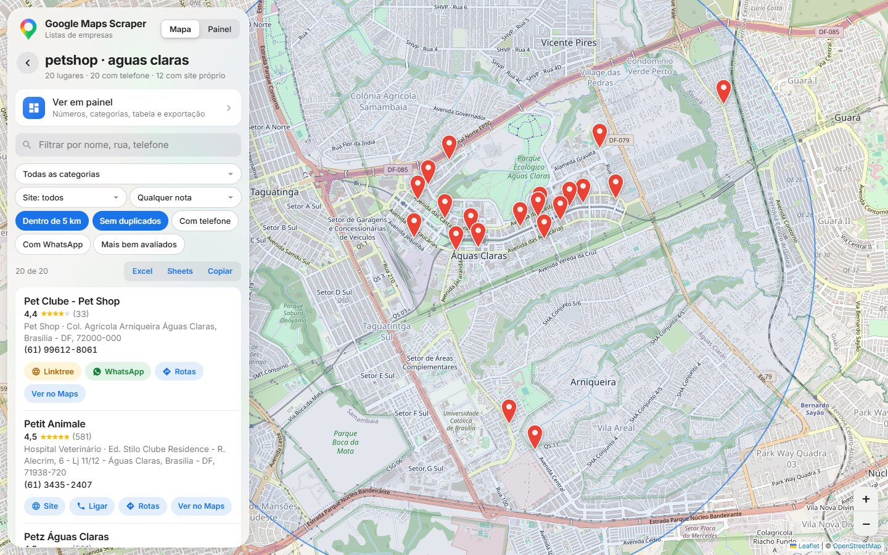
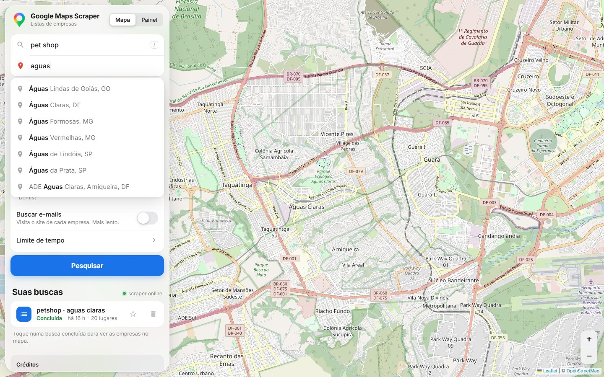
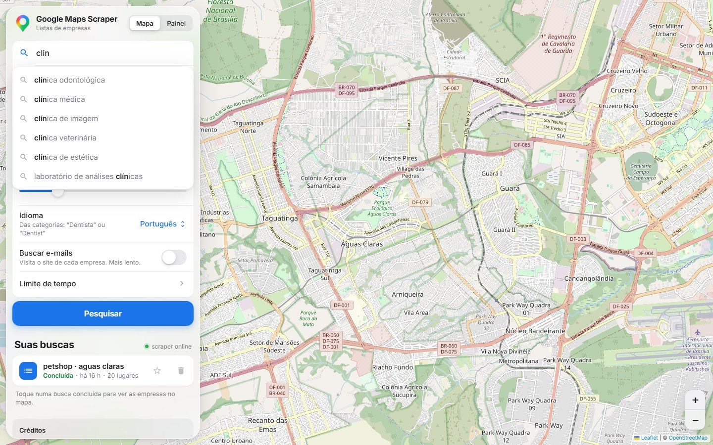
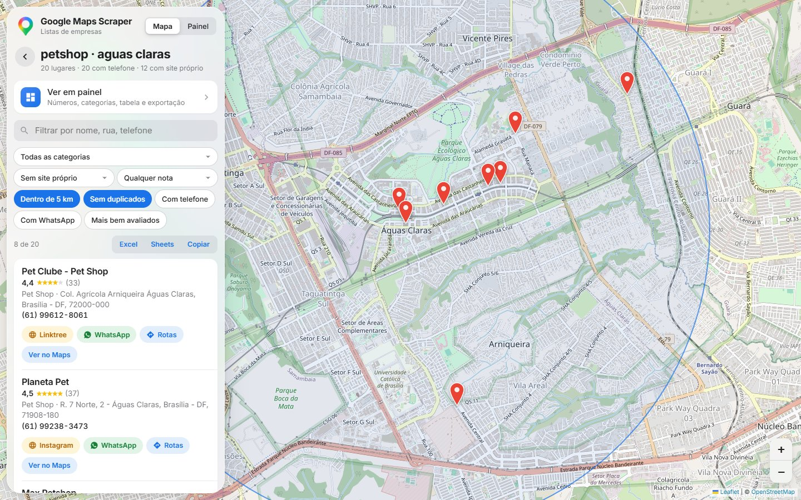
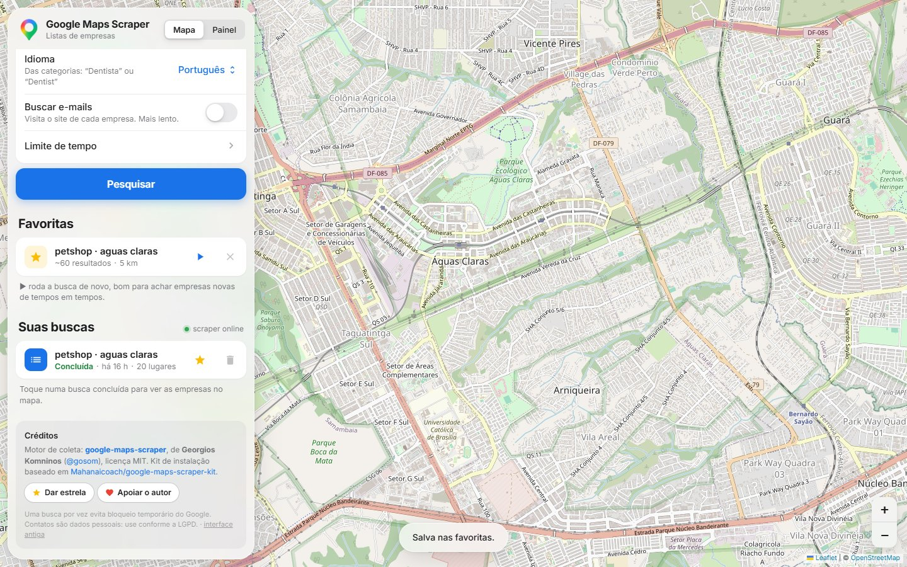
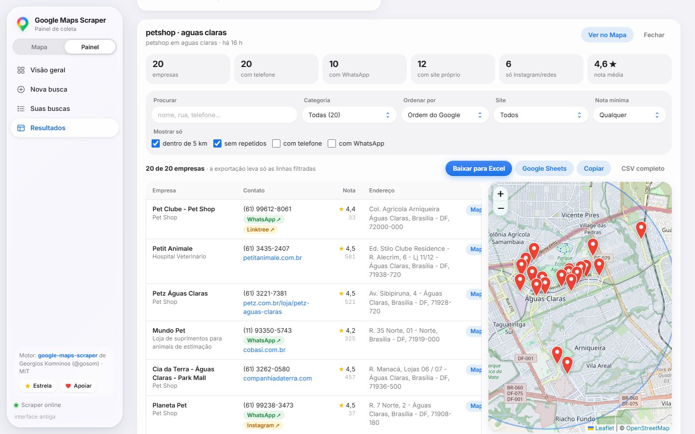

# Google Maps Scraper — Interface de Prospecção

Interface web para buscar empresas no Google Maps e transformar os resultados em listas de prospecção:
quem tem telefone, quem tem WhatsApp, quem tem site próprio e quem só tem Instagram.

Tudo roda **no seu computador**, via Docker, em `http://localhost:8080`.



## Telas

**Sugestões enquanto digita.** No "Onde?", bairros e cidades com nome parecido, com Brasil primeiro e os
lugares perto do mapa no topo. No "O que", tipos de negócio e as suas buscas anteriores.

| Onde? | O que você procura? |
|---|---|
|  |  |

**Filtro "Sem site próprio".** Empresas cujo link no Google é só Instagram, Linktree, Wix grátis etc.
aparecem destacadas em amarelo e entram como sem site, junto com quem não tem link nenhum.



**Buscas favoritas.** Marque com ☆ e rode de novo com ▶ para achar empresas novas.



**Painel.** Resumo, filtros, tabela e mapa lado a lado, com exportação para Excel e Google Sheets.



## Créditos

Este projeto **não** implementa a coleta de dados. Ele foi construído sobre:

- **[gosom/google-maps-scraper](https://github.com/gosom/google-maps-scraper)**, de Georgios Komninos
  (licença MIT): o motor que faz a coleta no Google Maps e expõe a API REST usada pela interface.
- **Google Maps Scraper Kit**, de Mahan ([mahanjafari-dev](https://github.com/mahanjafari-dev))
  (licença MIT): a configuração Docker/nginx, os scripts e a primeira versão da interface
  (modos Mapa e Painel), obtido de [vzbaggio/google-maps-scraper-kit](https://github.com/vzbaggio/google-maps-scraper-kit).

Os avisos de licença originais estão preservados em [LICENSE](LICENSE) e [CREDITS.md](CREDITS.md).
Se o projeto for útil para você, deixe uma ⭐ no [repositório do gosom](https://github.com/gosom/google-maps-scraper).

## O que esta versão adiciona na interface

**Busca**
- **Sugestões enquanto digita** no campo "O que você procura?": suas buscas anteriores e uma lista de
  ~200 tipos de negócio em português, sem diferenciar acentos (`acai` encontra "açaiteria").
- **Sugestões de lugares** no campo "Onde?" (via [Photon](https://photon.komoot.io), OpenStreetMap):
  bairros e cidades com nome parecido, Brasil primeiro e lugares próximos do mapa no topo
  (`aguas` → Águas Claras, DF). Navegação com ↑ ↓, Enter e Esc.
- **Buscas favoritas**: marque uma busca com ☆ e rode de novo com ▶ para encontrar empresas novas.

**Resultados** (abas Mapa e Painel)
- **Site próprio × rede social**: links para Instagram, Facebook, Linktree, iFood, Wix grátis,
  sites grátis do Google etc. contam como **sem site próprio**, aparecem destacados em amarelo
  e saem na exportação na coluna "Tipo de site".
- **Filtros de prospecção**: site (próprio / sem site próprio / só redes), nota mínima,
  com WhatsApp e com telefone.
- **Sem repetidos** mais preciso: a mesma empresa é reconhecida pelo link do Maps, ID do Google,
  telefone ou nome + endereço, comum em buscas com vários termos.

## Como rodar

Pré-requisito: [Docker Desktop](https://www.docker.com/products/docker-desktop) aberto.

```bash
docker compose up -d
```

Depois abra **http://localhost:8080**. Para parar:

```bash
docker compose stop
```

O passo a passo completo (scripts de linha de comando, solução de problemas, uso com o Claude Code)
está em [SETUP.md](SETUP.md).

## Estrutura

| Caminho | O que é |
|---|---|
| `frontend/` | A interface: `index.html` + `app.js` (modo Mapa) e `painel.html` + `painel.js` (modo Painel) |
| `docker-compose.yml`, `nginx.conf` | Sobe o scraper e o nginx que serve a interface em `localhost:8080` |
| `scripts/` | `scrape.py` / `scrape.sh` para buscar pela linha de comando |
| `.claude/` | Skill e comandos para o Claude Code operar o scraper |

## Uso responsável

- Use com moderação: muitas buscas seguidas, quantidades altas ou buscas agendadas **sem proxies**
  podem fazer o Google **bloquear temporariamente o seu IP**. Uma busca por vez é o mais seguro.
- Coletar dados do Google Maps vai contra os Termos de Serviço do Google.
- Telefones e e-mails de empresas são dados pessoais em muitos casos: siga a **LGPD** ao usar e
  armazenar esses contatos.
- A API do scraper não tem autenticação e fica presa a `127.0.0.1`. Não a exponha na internet.

## Licença

MIT. Veja [LICENSE](LICENSE) (kit) e [CREDITS.md](CREDITS.md) (motor de coleta, gosom).
